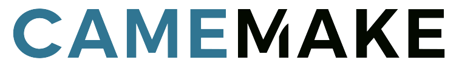

<p align="center">
  
</p>

<h1 align="center">CameVision EGO</h1>

<p align="center">
  <strong>CV-EGO01-OS</strong> · Dual global-shutter AI stereo camera<br>
  Open stereo vision platform for SLAM, robotics, VIO and spatial AI
</p>

<p align="center">
  <a href="https://www.camemake.eu/shop/cv-ego01-os-camevision-ego-dual-global-shutter-ai-stereo-camera-2414"><strong>Buy CameVision EGO</strong></a>
  ·
  <a href="https://www.camemake.eu/robotic-solutions"><strong>Camemake robotic solutions</strong></a>
  ·
  <a href="https://camemake.github.io/CameVision-Ego/"><strong>Product page</strong></a>
  ·
  <a href="https://www.camemake.eu">camemake.eu</a>
</p>

---

**CameVision EGO** is a Camemake product: two hardware-synchronised 2.3 MP global-shutter cameras, one IMU per camera, an on-board vision processor with NPU, USB, Wi-Fi 6, BLE, eMMC and battery support — in one compact board.

This repository is the **open demo software** that ships with the product. Stereo matching, depth, calibration and the live page all run **on the camera**. The host only deploys over USB and opens a browser.

OEM / ODM variants (single, triple, 5-fold and 9-camera PCBs, plus headset, cap, helmet, backpack and gripper products) are documented on the [Camemake robotic solutions](https://www.camemake.eu/robotic-solutions) page.

## Product

| | CameVision EGO · CV-EGO01-OS |
|---|---|
| Cameras | 2 × global shutter (SC233HGS · OG02C10 · MIRA220 · AR0235 colour/mono · OX05B1S · Kaimou GS2.3) |
| IMU | 2 × LSM6DSVQTR (16-bit; ST typical 60 µg/√Hz · 2.8 mdps/√Hz; ±2…16 g / ±125…4000 dps) |
| Compute | On-board vision SoC with integrated NPU |
| Memory | 1 GB RAM |
| Storage | 16 GB eMMC + microSD slot |
| Wired | USB (developer / ADB gadget) · USB-C |
| Wireless | Wi-Fi 6 + BLE |
| Power | USB-C and battery pads |
| Software | This GitHub demo (on-board stereo, calibration, IMU HUD) |
| Applications | SLAM, VIO, robotics, egocentric and spatial AI |

Evaluation pricing and volume breaks are on the [webshop listing](https://www.camemake.eu/shop/cv-ego01-os-camevision-ego-dual-global-shutter-ai-stereo-camera-2414) (MOQ 10). For brand-label boards, custom baseline, housing or volume, contact [sales@camemake.com](mailto:sales@camemake.com).

Hardware revision in this tree: **CameVision Ego V1.I1**.

## Get started

Flash starts from **Maskrom**. Same path on an empty board and on a board that already has images. USB stays ADB.

```
python tools/cv_ego_flash.py --prebuilt --package camevision-ego
python tools/cv_ego_flash.py --prebuilt --package camevision-ego-am
python tools/cv_ego_page.py
```

1. **USB / Maskrom** — Install USB driver. Hold BOOT, tap RESET, keep BOOT held.
2. **Package** — Write loader, env, idblock, U-Boot, boot, userdata, oem, rootfs, then the overlay.
3. **ADB** — `cv_ego_page.py` forwards the on-board stereo page and IMU HUD, then opens a browser.

Shop sensors: SC233HGS, OG02C10, MIRA220, AR0235 (colour or mono), OX05B1S, Kaimou GS2.3. Maskrom kits in this tree are SC233HGS and AM / MIRA220.

Full map: [`FLASH.md`](FLASH.md) · [flash.html](https://camemake.github.io/CameVision-Ego/flash.html)

## Repository layout

```
docs/                           GitHub Pages
  flash.html                    Maskrom partition map
  hardware.html                 Fitted parts and pinmux
  mechanical.html               Housing, thermal, assembly
  optics.html                   Modules, FOV, baseline
  software.html                 Drivers, boot chain, live routes
tools/                          Host deploy and on-board sources
  cv_ego_flash.py               Maskrom write, then overlay
  cv_ego_overlay_deploy.py      ADB copy into /userdata
  ego_stereo.py                 Live stereo, depth, calibration HTTP
  ego_cam_sync.py               Hardware FSYNC / EFSYNC
  ego_imu_hud.py                IMU HUD
  stereo_native.c               Native matcher
device-tree/                    CameVision Ego board tree (no PCB schematic)
restore/release-0.2-20260902/   SC233HGS Maskrom kit: loader, env, idblock, U-Boot, boot, userdata, oem, rootfs + overlay
device-tree/rv1126b-camevision-ego-sc233hgs.dts
                                Frozen SC233HGS board tree
restore/mira220-bringup/        MIRA220 on RV1126B (starts from the SC233HGS flash)
FLASH.md                        Maskrom from the command line
WIFI.md                         VS6621 / BSS84 / STA
```

PCB schematics, netlists and the schematic PDF are not in this repository.

## Hardware notes (this board)

CameVision Ego V1.I1. The shipped flash in this tree is **SC233HGS**: two global-shutter imagers at 1920×1200, four MIPI lanes per eye, and one IMU beside each camera. That kit is frozen as `restore/release-0.2-20260902` (`SENSOR=SC233HGS`) and `device-tree/rv1126b-camevision-ego-sc233hgs.dts`. A second Ego with **MIRA220** uses the same board flash first, then camera-node changes (see `restore/mira220-bringup/`).

| Eye | CSI | Control | Power-down | Sync | Trigger | IMU |
|---|---|---|---|---|---|---|
| CAM0 | CSI RX0, 4-lane | I2C3 `@0x30` | GPIO4_A3 | GPIO4_A1 → FSYNC | GPIO6_C2 → EFSYNC | SPI0 |
| CAM1 | CSI RX1, 4-lane | I2C-GPIO `@0x30` | GPIO4_A2 | GPIO4_A0 → FSYNC | GPIO6_C3 → EFSYNC | SPI1 |

CAM1 I2C SCL/SDA are swapped on the PCB versus the SoC I2C4 functions, so that eye is bit-banged. CSI RX1 uses the 4-lane PHY on that port (not the 2-lane split of CSI0).

Trigger mode is **continuous** on both sensors. Slave-mode HDR bits stay off so the 3A stack still owns exposure. Trigger rate is 12.5 fps; programmed VTS remains 15.

Fitted memory is **1 GB** DDR (the schematic 512 MB label is wrong). Both IMUs are the same part. eMMC is `BWCTAK611G16G`.

## Camemake robotic family

CameVision EGO is the **dual-camera** board in the CameVision family. The same platform is offered as ODM PCBs and finished goods:

| Cameras on the PCB | Role |
|---|---|
| 1 | Monocular / tool camera |
| **2 (EGO)** | Hardware-synced stereo |
| 3 | Stereo plus a context camera |
| 5 | Timed array (wearable / backpack) |
| 9 | Near-surround workplace capture |

Finished ODM products on the same family include a stereo headset, cap, PPE helmet, 5-fold array with backpack, and a handheld teaching gripper.

Read the family, ODM / OEM paths and Camemake Lens (Shenzhen R&D) on **[Camemake robotic solutions](https://www.camemake.eu/robotic-solutions)**.

Every Camemake camera module can be tailored — sensor, lens, housing, interface and firmware. Request a quote from the [shop page](https://www.camemake.eu/shop/cv-ego01-os-camevision-ego-dual-global-shutter-ai-stereo-camera-2414) or email [sales@camemake.com](mailto:sales@camemake.com).

## Documentation

| Page | What it covers |
|---|---|
| [Product page](https://camemake.github.io/CameVision-Ego/) | Public GitHub Pages site for this product |
| [Get started](https://camemake.github.io/CameVision-Ego/start.html) | USB, package, ADB |
| [Flash](https://camemake.github.io/CameVision-Ego/flash.html) | Maskrom, partition map, overlay |
| [Hardware](https://camemake.github.io/CameVision-Ego/hardware.html) | Camera map, GPIO, fitted parts, IMU precision |
| [Mechanical](https://camemake.github.io/CameVision-Ego/mechanical.html) | Thermal path, housing, assembly |
| [Optics](https://camemake.github.io/CameVision-Ego/optics.html) | Modules, FOV, baseline |
| [Software](https://camemake.github.io/CameVision-Ego/software.html) | Drivers, boot chain, live-page routes |
| [Datasheet](https://camemake.github.io/CameVision-Ego/datasheet.html) | SKU table · IMU precision |
| [`FLASH.md`](FLASH.md) | Maskrom from the command line |
| [`EGO.md`](EGO.md) | Full board notes |
| [`WIFI.md`](WIFI.md) | VS6621 / BSS84 / STA |
| [`RELEASE.md`](restore/release-0.2-20260902/RELEASE.md) | Flash V0.2 |

## FAQ

**Where do I buy boards or ask for ODM?** The [webshop listing](https://www.camemake.eu/shop/cv-ego01-os-camevision-ego-dual-global-shutter-ai-stereo-camera-2414) and [Camemake robotic solutions](https://www.camemake.eu/robotic-solutions). Email [sales@camemake.com](mailto:sales@camemake.com).

## Support

- Product and orders: [camemake.eu](https://www.camemake.eu) · [sales@camemake.com](mailto:sales@camemake.com)
- This repository is the open demo for **CameVision EGO** only. 

## License

Camemake's demo software, board device-tree sources, and documentation in this repository are released under the [MIT License](LICENSE).

Third-party pieces keep their own terms. That includes the embedded Python under `host/python`, the Rockchip USB driver assistant, UnRAR, and the prebuilt Linux boot images under `restore/`. PCB schematics are not in this repository.

The same file is on the product pages: [LICENSE](https://camemake.github.io/CameVision-Ego/LICENSE).

© Camemake. CameVision EGO · CV-EGO01-OS.
